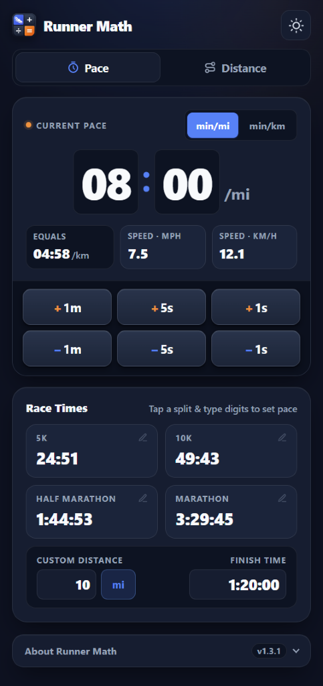
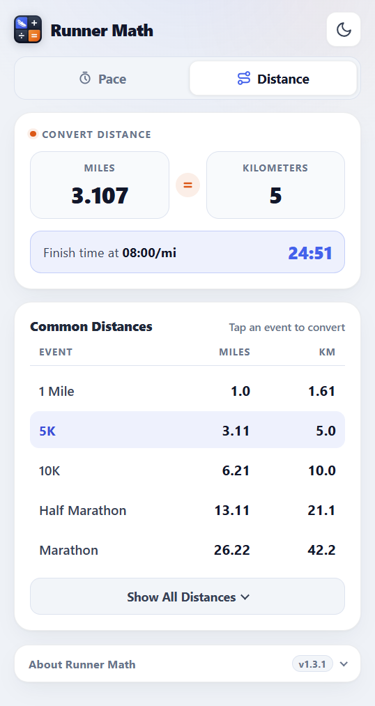

# Runner Math

A fast, offline-capable Progressive Web App (PWA) for runners to convert paces, treadmill speeds, distances, and race times.

**Live App:** [https://runner-math.khomyak.net/](https://runner-math.khomyak.net/)

<table>
  <tr>
    <th>Pace &amp; Race Splits (Dark Mode)</th>
    <th>Distance Converter (Light Mode)</th>
  </tr>
  <tr>
    <td align="center" valign="top">
      
    </td>
    <td align="center" valign="top">
      
    </td>
  </tr>
</table>

## Features
- **Pace Converter**: Switch seamlessly between `min/mi` and `min/km` without rounding drift, with auto-advancing `MM:SS` entry and press-and-hold quick adjustment keys (`±1m`, `±5s`, `±1s`).
- **Treadmill Speed Converter**: View and edit `mph` and `km/h` speeds right alongside your running pace.
- **Race & Custom Distance Splits**: Instantly view finish times for 5K, 10K, Half Marathon, Marathon, or any custom `mi`/`km` distance.
- **Stopwatch-Style Reverse Pace Entry**: Tap any split and type digits right-to-left (e.g., `2000` → `20:00`, `13000` → `1:30:00`) to calculate the exact pace required.
- **Distance Converter**: Convert miles and kilometers (supporting `.` and `,` decimals) with exact presets for track, road, and ultra distances—plus estimated finish times at your current pace.
- **Mobile-First UX**: Interactive horizontal swipe gestures between tabs, mobile-optimized numeric/decimal keypads, and persistent settings across sessions.
- **Offline Ready & Installable**: Works completely offline as a home-screen PWA on iOS, Android, and desktop, with automatic background updates.
- **Dark Mode**: Adapts automatically to system color scheme preferences with manual toggle support.

## Tech Stack
- Vanilla HTML, CSS, and JavaScript
- Zero build tools or external dependencies

## Local Development & Testing
Open `index.html` directly in a browser, or run any static server to test Service Worker / PWA installation locally:

```bash
python -m http.server 8000
```

Run the unit and PWA asset/version integrity tests with Node.js:

```bash
node test.js
```

## License
Released under the [MIT License](LICENSE).
